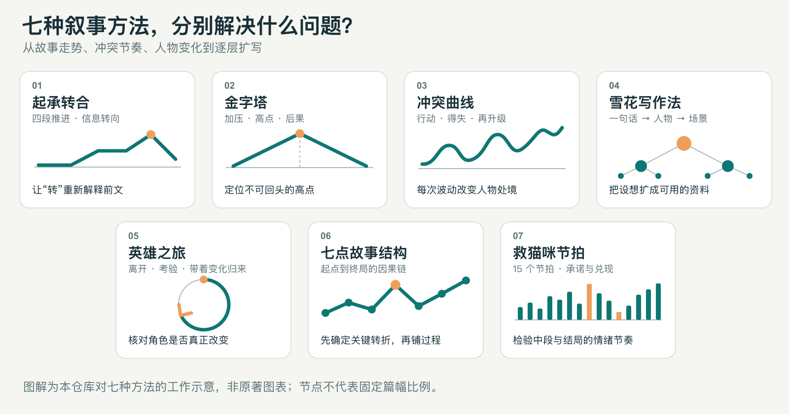

# ⚙️ Long-Novel-Architect｜长篇小说架构师

**把一个脑洞交给七种经典写作方法会诊，推演成可持续推进的长篇结构。**

长篇最难的部分，往往从精彩开局之后开始：事件如何一环扣一环，人物凭什么改变，每一卷又如何产生新的目标？本 Skill 把七种叙事方法转成可执行的诊断表、结构路由和续航检查，帮助作者在动笔前看见这些问题。

[设计哲学](#设计哲学先给长篇做压力测试) · [七大结构矩阵](#七大结构诊断矩阵) · [执行流程](#技能执行流) · [完整试跑报告](long-novel-architect/examples/yapo-dalisi-output.md) · [在 Popwave 继续创作](#在-popwave-继续创作)



> 图解由本仓库制作，表示七种方法的工作重点；曲线和节点不代表固定的篇幅比例。

## 设计哲学：先给长篇做压力测试

**一个好开头，需要一套能持续运作的故事机制。**本 Skill 从三个层面检查它：

1. **因果链**：关键事件是否由人物选择推动？删去一个节点，后面的故事会不会照样发生？
2. **人物线**：外部胜负是否改变人物的做法、关系或处境？如果人物保持稳定，这种稳定有没有持续接受考验？
3. **连载线**：每卷结束时，目标、资源、关系或规则是否真的发生变化？下一卷的任务从哪里长出来？

输入可以是一句话脑洞、一份已有设定，或一段市场趋势。Skill 会先记录作者已确定的内容，再诊断结构缺口；新补的案件、规则与人物关系会标明为**创作提案**。

```text
脑洞 / 已有设定 / 市场信号
             ↓
       七种方法逐项诊断
             ↓
       选择 1 主 + 至多 2 辅
             ↓
    全书因果链 → 分卷任务 → 前三章
             ↓
     中段续航与结局兑现检查
```

## 七大结构诊断矩阵

### 01｜故事骨架：转折要互相咬合

| 方法 | 执行动作 | 主要产物 |
|---|---|---|
| **七点故事结构** | 从终局反推起点、中点、两次转折与两次压力，逐点检查“前一步如何迫使下一步发生”。 | 七节点因果表 |
| **起承转合** | 安排起势、发展、信息转向与重新理解，让「转」改变前文的意义。 | 四段信息变化表 |
| **金字塔结构** | 排出引发事件、逐级加压、不可回头的高点与其后果。 | 卷级压力链 |

### 02｜连载动力：每次行动都改变处境

| 方法 | 执行动作 | 主要产物 |
|---|---|---|
| **冲突曲线** | 追踪行动、得失、代价与新目标，检查中段事件能否互换顺序。 | 多轮得失与升级表 |
| **救猫咪节拍** | 检查开篇承诺、中点变化、重大失去与最终兑现；作为主方法时展开完整十五节拍。 | 节拍功能表 |

### 03｜人物与扩写：让设想变成可写材料

| 方法 | 执行动作 | 主要产物 |
|---|---|---|
| **英雄之旅** | 追踪角色的旧位置、跨越门槛、接受考验和变化后的行动。 | 人物变化线 |
| **雪花写作法** | 从一句话梗概，逐层扩展人物、阶段故事和场景清单，后层发现问题时回改前层。 | 逐层设计文档 |

这些方法处于不同层级。Skill 会为同一个故事逐项写出**适用问题、具体动作、产出物与边界**，再说明为什么选定某个主方法。[查看完整方法手册与诊断路由 →](long-novel-architect/references/structure-guide.md)

## 技能执行流

### Step 1｜输入脑洞或市场信号

给出你已有的人物关系、强情节和结局约束即可。没有故事时，也可以先提供来自 [Popwave 网文情报站 Daily](https://popwave.cn/work/daily)的趋势摘要。Skill 会区分**原案、资料与新提案**；用户提供的趋势不会被写成已经独立核验的事实。

### Step 2｜七法交叉诊断，自动选择主轴

Skill 逐一检查分段、因果、压力、连续得失、人物变化、读者节拍与资料完整度。选择规则很具体：**优先处理最会阻断下一阶段写作的缺口**，再从其他层级挑选辅助方法。作者指定主方法时，按指定方法完整展开。

### Step 3｜交付长篇架构与续航预警

输出包含主方法的完整结构表、人物线、全书主问题、分卷目标、前三章任务，以及中段可能重复的环节。每卷必须说明**目标、行动、代价和导致下一卷的变化**。如果当前材料支撑不了长篇，报告会指出缺口，并给出可替换的事件线提案。

### Step 4｜带着结构稿继续写

结构稿采用普通 Markdown，可以在本地 Agent 中继续修改，也可以交给 [Popwave 创作工作区](https://popwave.cn/work/)的写作专家，继续立项、设定、剧情编排和章节写作。当前衔接方式是**复制结构稿与接力指令**。

## 诊断与输出示例

下面是[试跑报告](long-novel-architect/examples/yapo-dalisi-output.md)的摘要；案例只用于展示技法如何做出结构决策。

```text
输入：市井牙婆女 × 守律的大理寺评事
原案锚点：婚讯南逃 → 山洪假死 → 多年后街市重逢

七法诊断：
  七点故事结构  强转折已具备，适合锁定全书因果链
  英雄之旅      双主角的关系位置与做法需要各自变化
  雪花写作法    案件、时间线和分卷资料仍需逐层展开

结构选择：七点故事结构为主；英雄之旅与雪花写作法为辅
续航预警：重逢之后缺少已确定的持续事件线
可选提案：以“身契疑案”连接女主的牙行经验与男主的办案职责
```

**[查看七种方法的逐项判断、七节点结构与前三章任务 →](long-novel-architect/examples/yapo-dalisi-output.md)**  
案例中的“身契疑案”是本次推演的提案，并非原案已有情节。

## 理论溯源与核心参数

七种方法的源流不同。本仓库提供自己的长篇应用流程，并把可核对的方法来源与改编边界列在一起。

| 方法 | 本 Skill 使用的核心参数 | 方法来源或边界 |
|---|---|---|
| **七点故事结构** | Hook、Plot Turn 1、Pinch 1、Midpoint、Pinch 2、Plot Turn 2、Resolution | [Dan Wells 的公开讲座](https://www.youtube.com/watch?v=KcmiqQ9NpPE) |
| **雪花写作法** | 一句话 → 一段式 → 角色动机 → 阶段梗概 → 场景清单 | [Randy Ingermanson 的十步说明](https://www.advancedfictionwriting.com/articles/snowflake-method/)；本 Skill 用其中的开书设计层 |
| **英雄之旅** | 离开 → 考验／启蒙 → 带着变化归来 | [Joseph Campbell Foundation 的说明](https://www.jcf.org/learn/joseph-campbell-heros-journey)；不强制套齐流行的小步骤 |
| **救猫咪节拍** | 十五节拍；开场、中点、重大失去与终场的对应 | [Save the Cat! 官方节拍工具](https://savethecat.com/beat-mapper)；长篇应用为本仓库改编 |
| **金字塔结构** | 初始局面、加压、高点与后果 | [Freytag《戏剧的技巧》](https://www.gutenberg.org/ebooks/50616)；在此用于卷级压力检查 |
| **起承转合** | 起、承、转、合四段的信息变化 | 参照[相关的起承転結研究](https://textjournal.scholasticahq.com/article/146391-kishotenketsu-and-its-potential-applications-to-prose-writing)；不将两者完全等同 |
| **冲突曲线** | 行动 → 得失 → 处境变化 → 新目标 | 本仓库的工作定义，不声称存在唯一的原版曲线 |

完整操作表、验收项和来源说明见[方法手册](long-novel-architect/references/structure-guide.md)。

## 安装与使用

下载此仓库后，在仓库根目录将整个 Skill 文件夹放进支持 Skills 的 Agent 目录。以 Codex 为例：

```bash
cp -R long-novel-architect ~/.codex/skills/
```

然后输入：

> 用 long-novel-architect 分析我的长篇脑洞。让七种方法逐一诊断，选出主方法，交付全书节点、分卷推进和前三章任务。保留我已确定的情节，新增内容标为提案。［粘贴脑洞］

也可以指定“以起承转合作为主方法”，或只要求比较七种技法。Skill 的完整执行规则在 [SKILL.md](long-novel-architect/SKILL.md)。

## 在 Popwave 继续创作

想把结构稿推进到立项和连载，可打开 [**Popwave 创作工作区**](https://popwave.cn/work/)：新建小说项目，选择已有的写作专家，把结构稿与[接力指令](long-novel-architect/examples/yapo-dalisi-output.md#交给-popwave-的下一步)粘贴进去。本案例可由「雪花流写作专家」继续处理设定、剧情、章纲与正文。

需要先找方向时，[**Popwave Daily**](https://popwave.cn/work/daily)提供趋势、榜单与写作情报；已有脑洞时可直接从结构诊断开始。

## 仓库目录

```text
README.md
LICENSE                                      MIT 开源许可
docs/seven-structures.png                     七种方法总览图
long-novel-architect/
├── SKILL.md                                   执行流程与交付门槛
├── references/structure-guide.md              七种方法的操作、验收与来源
└── examples/
    ├── yapo-dalisi-input.md                   案例输入边界
    └── yapo-dalisi-output.md                  完整试跑报告
```

## 许可

本仓库以 [MIT 许可证](LICENSE)开放使用。
